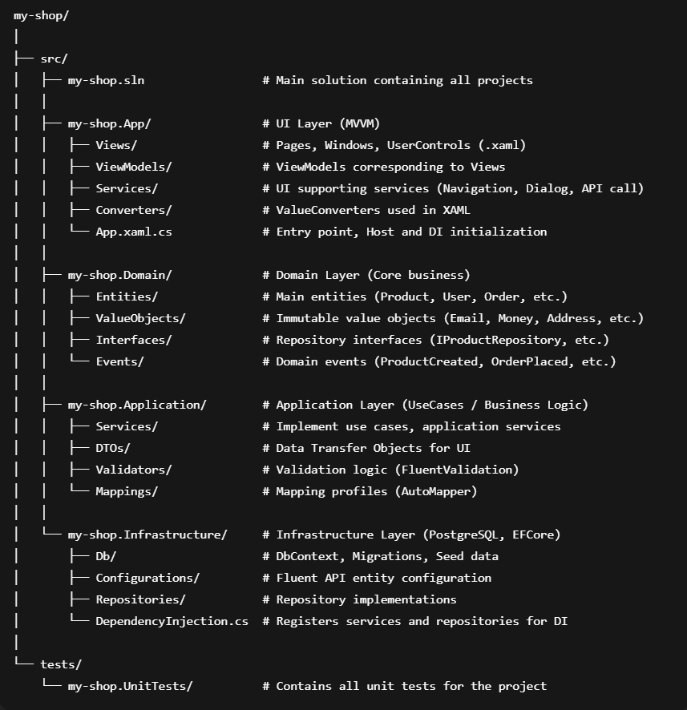
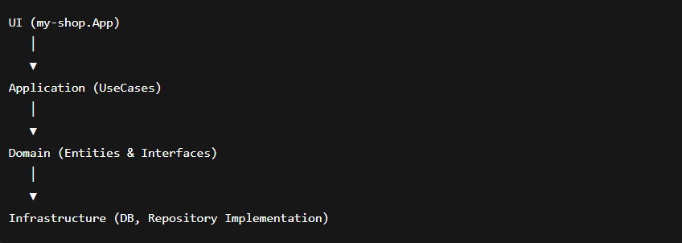

# 📦 MyShop – Repository Structure

The **MyShop** project is built with **C# / .NET**, following **Clean Architecture**, using **MVVM** for UI and **Dependency Injection Hosting** for application startup.  
The database uses **PostgreSQL** via **Entity Framework Core**.

The repository is organized to be **modular, maintainable, and easily extensible**, separating UI, business logic, and data access layers.

---

## 📁 Repository Structure

---

## 🧱 Layer Descriptions

### 1️ - MyShop.App – UI Layer (MVVM)
- Contains Views and ViewModels following **MVVM pattern**  
- Uses **MVVM Toolkit** or other MVVM frameworks  
- Handles UI logic, data binding, and commands  
- All dependencies are injected via **HostBuilder**  
- Does **not** directly access the database  

---

### 2️ - MyShop.Domain – Domain Layer
- Contains **entities**, **value objects**, **domain events**, **exceptions**  
- Defines **repository interfaces**  
- Does **not** depend on other layers  
- No EFCore, no UI logic  

> This is the **core of the application**.

---

### 3️ - MyShop.Application – Application Layer
- Implements **business logic / use cases**  
- Contains **DTOs** for UI  
- Handles **mapping** (AutoMapper) and **validation** (FluentValidation)  
- Depends only on **Domain Layer**, not directly on Infrastructure  

---

### 4️ - MyShop.Infrastructure – Infrastructure Layer
- Implements **database access** (EF Core + PostgreSQL)  
- Implements **repositories** defined in Domain  
- Configures **DB connection, migrations**  
- Provides supporting services (File Storage, Email, Logging, etc.)

---

## 🔗 Layer Relationships

UI → Application: UI calls UseCases / Services
Application → Domain: Application uses Domain entities and repository interfaces
Domain → Infrastructure: Infrastructure implements repository interfaces
Infrastructure ↔ Application: Application gets concrete implementations via DI